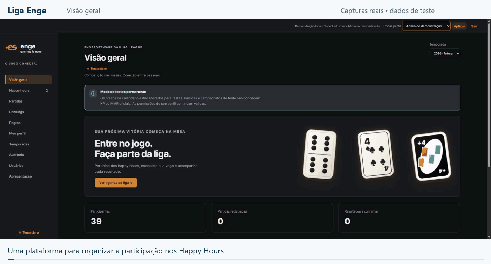

Sou **QA júnior na Engesoftware, com mais de 3 anos de experiência** em sistemas corporativos e governamentais. Minha atuação reúne testes manuais, análise de requisitos, documentação de evidências e automação de testes.

[LinkedIn](https://www.linkedin.com/in/guilherme-hansen-goncalves/) · [E-mail](mailto:ghansengoncalves@gmail.com)

### Projeto em destaque: Liga Enge

Conduzo o **desenvolvimento de ponta a ponta da Liga Enge com apoio de IA**, desde os requisitos e as regras de negócio até a implementação, a lógica de testes, a validação manual e a evolução do produto.

A plataforma organiza os Happy Hours da Engesoftware com inscrições, partidas, campeonatos, resultados e rankings de **Truco, Dominó e UNO**.

*Capturas reais da aplicação local na branch develop, com dados de teste. Os campeonatos da área Apresentação são cenários fictícios prontos; a sequência não representa uma competição real nem um relatório de execução de testes.*

[Ver imagem estática](assets/liga-enge-demo.png) · [Referência do projeto — repositório privado](https://github.com/GhansenGoncalves/liga-enge/tree/develop)

Minha atuação no ciclo de desenvolvimento

- **Requisitos:** definição e revisão de HUs, regras de negócio, mensagens e critérios de aceite.
- **Implementação:** desenvolvimento das interfaces, da API e da persistência, com apoio de IA e revisão das entregas.
- **Lógica de negócio:** inscrições, permissões por perfil, chaveamento, placares, homologação, contestação e pontuação.
- **Qualidade:** definição da lógica de testes, cenários positivos e negativos e validação manual dos fluxos.
- **Evolução:** identificação e correção de problemas de comportamento e usabilidade e organização das alterações no GitHub.

**Tecnologias do projeto:** TypeScript, React, Node.js, Express e PostgreSQL. A IA integra o processo de desenvolvimento; eu direciono as funcionalidades e avalio as entregas e o funcionamento do produto.

O sistema está em desenvolvimento e utiliza massas de teste. O código permanece privado.

### Automação com Cypress: PNUD

Automatizei etapas do cadastro de **Produto Técnico Equivalente com Cypress e JavaScript**: navegação, preenchimento de campos, consultas e verificações da interface.

Ver script animado e minha contribuição na automação

*Animação com visual inspirado no Visual Studio Code e trecho adaptado do script implementado. Os dados são fictícios e o terminal é ilustrativo; não se trata de uma gravação de execução nem de um resultado de teste.*

[Ver imagem estática](assets/pnud-fluxo-cypress.png)

- Navegação até o formulário de cadastros.
- Preenchimento de campos e interação com listas e janelas de confirmação.
- Verificações de título, endereço e elementos apresentados na interface.
- Interceptação de uma requisição para acompanhar uma etapa do fluxo.

Também atuei em testes de requerimentos, documentos, publicações e acompanhamento de processos do projeto. O código corporativo permanece em repositório privado.

### Experiência em projetos

Entregas selecionadas da minha atuação. Os exemplos resumem atividades reais e preservam informações internas dos sistemas.

| Projeto | Minha atuação | Exemplo de entrega |
| --- | --- | --- |
| **PNUD** | Automação e testes funcionais | Automação de etapas do cadastro com Cypress e JavaScript. |
| **Terracap** | Requisitos e testes manuais | Especificação de requisitos e teste da anonimização de PDF. |
| **Telebras** | Testes manuais | Validação de acessibilidade de tabelas, navegação por teclado, formulários e relatórios. |
| **SEFAZ-CE** | Regras de negócio e testes manuais | Teste da validação de férias no cadastro de ocorrências de afastamento do SGS. |
| **Liga Enge** | Desenvolvimento de ponta a ponta com IA e qualidade | Requisitos, regras de negócio, implementação, lógica de testes e validação manual. |

Requisitos e cenários de teste

Na Terracap, trabalhei com especificação e revisão de requisitos e testes de funcionalidades administrativas. Na SEFAZ-CE, analiso HUs e preparo roteiros com comportamento esperado, regras de negócio e critérios de aceite.

Na Liga Enge, a documentação inclui histórias de usuário, regras de negócio, mensagens e critérios de aceite. Um exemplo adaptado é a inscrição em competições:

> **Regra:** o participante não pode ter inscrições duplicadas no mesmo campeonato.
>
> **Cenário:** dado que o participante já está inscrito, quando tenta uma segunda inscrição, então o sistema não cria outro registro e informa a duplicidade.

Esse trecho representa um critério documentado; não é um relatório de execução de teste.

### Como trabalho

- Execução de testes manuais, funcionais, regressão, aceitação e caixa-preta.
- Criação, manutenção e organização de casos de teste no **Azure Test Plans**.
- Registro de evidências e defeitos no **Jira**, com documentação em **Markdown**.
- Análise de regras de negócio e apoio à especificação e revisão de requisitos.
- Colaboração com desenvolvimento, analistas e gestores.

**Ferramentas presentes nas entregas:** Cypress, JavaScript, Jira, Azure Test Plans, Markdown, Git e GitHub.
