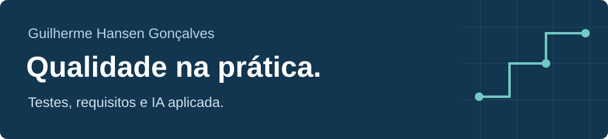
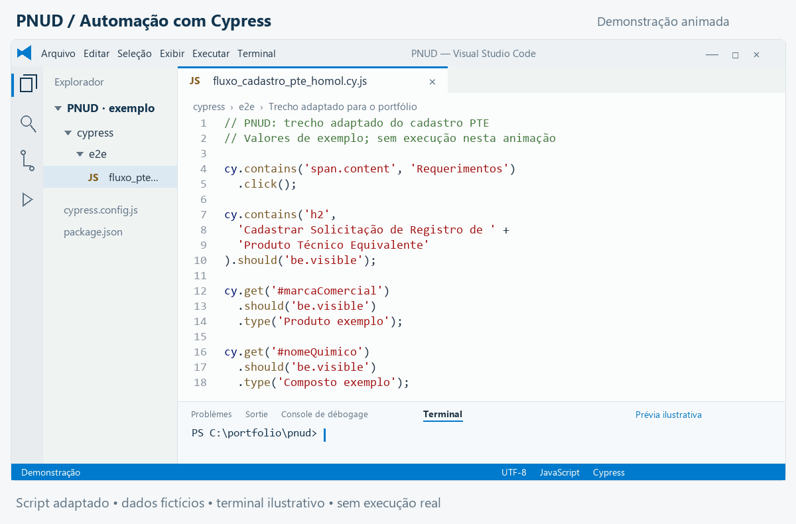

Sou **QA júnior na Engesoftware, com mais de 3 anos de experiência** em sistemas corporativos e governamentais. Minha atuação reúne testes manuais, análise de requisitos, documentação de evidências e automação de testes.

[LinkedIn](https://www.linkedin.com/in/guilherme-hansen-goncalves/) · [E-mail](mailto:ghansengoncalves@gmail.com)

### Automação em destaque: PNUD

Automatizei etapas do cadastro de **Produto Técnico Equivalente com Cypress e JavaScript**: navegação, preenchimento de campos, consultas e verificações da interface.

*Animação com visual inspirado no Visual Studio Code e trecho adaptado do script implementado. Os dados são fictícios e o terminal é ilustrativo; não se trata de uma gravação de execução nem de um resultado de teste.*

[Ver imagem estática](assets/pnud-fluxo-cypress.png)

Minha contribuição na automação

- Navegação até o formulário de cadastros.
- Preenchimento de campos e interação com listas e janelas de confirmação.
- Verificações de título, endereço e elementos apresentados na interface.
- Interceptação de uma requisição para acompanhar uma etapa do fluxo.

Também atuei em testes de requerimentos, documentos, publicações e acompanhamento de processos do projeto. O código corporativo permanece em repositório privado.

### Experiência em projetos

Entregas selecionadas da minha atuação. Os exemplos resumem atividades reais e preservam informações internas dos sistemas.

| Projeto | Minha atuação | Exemplo de entrega |
| --- | --- | --- |
| **PNUD** | Automação e testes funcionais | Automação de etapas do cadastro com Cypress e JavaScript. |
| **Terracap** | Requisitos e testes manuais | Especificação de requisitos e teste da anonimização de PDF. |
| **Telebras** | Testes manuais | Validação de acessibilidade de tabelas, navegação por teclado, formulários e relatórios. |
| **SEFAZ-CE** | Regras de negócio e testes manuais | Teste da validação de férias no cadastro de ocorrências de afastamento do SGS. |
| **Liga Enge** | IA, histórias de usuário e testes manuais | Direcionamento de funcionalidades, organização de HUs e validação de uma plataforma em desenvolvimento. |

Requisitos e cenários de teste

Na Terracap, trabalhei com especificação e revisão de requisitos e testes de funcionalidades administrativas. Na SEFAZ-CE, analiso HUs e preparo roteiros com comportamento esperado, regras de negócio e critérios de aceite.

Na Liga Enge, a documentação inclui histórias de usuário, regras de negócio, mensagens e critérios de aceite. Um exemplo adaptado é a inscrição em competições:

> **Regra:** o participante não pode ter inscrições duplicadas no mesmo campeonato.
>
> **Cenário:** dado que o participante já está inscrito, quando tenta uma segunda inscrição, então o sistema não cria outro registro e informa a duplicidade.

Esse trecho representa um critério documentado; não é um relatório de execução de teste.

Como aplico IA na Liga Enge

A Liga Enge organiza inscrições, partidas, regras, resultados e rankings de Truco, Dominó e UNO nos eventos da empresa.

O desenvolvimento utiliza IA como apoio à implementação e à organização técnica. Minha participação envolve direcionar o comportamento esperado, revisar as entregas, organizar HUs e conferir manualmente o funcionamento do sistema.

As validações orientaram melhorias nas mensagens de sucesso e erro, nas confirmações em modal e na gestão de inscrições. O projeto está em desenvolvimento.

### Como trabalho

- Execução de testes manuais, funcionais, regressão, aceitação e caixa-preta.
- Criação, manutenção e organização de casos de teste no **Azure Test Plans**.
- Registro de evidências e defeitos no **Jira**, com documentação em **Markdown**.
- Análise de regras de negócio e apoio à especificação e revisão de requisitos.
- Colaboração com desenvolvimento, analistas e gestores.

**Ferramentas presentes nas entregas:** Cypress, JavaScript, Jira, Azure Test Plans, Markdown, Git e GitHub.
